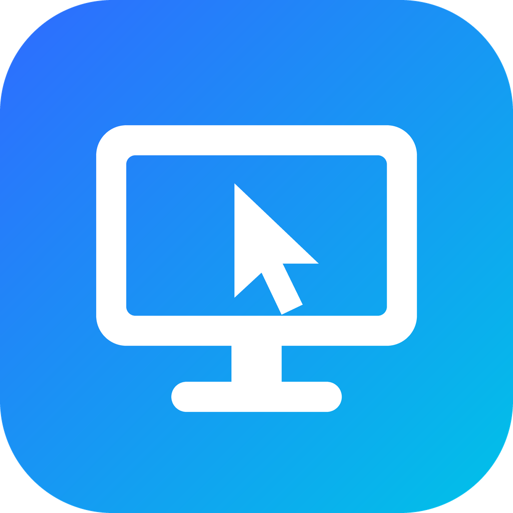

<p align="center">
  <br>
  <b>super远程桌面（SuperDesk）</b><br>
  服务器自建、开箱即用的远程桌面，带自研管理后台 super控制台
</p>

<p align="center">
  <a href="LICENCE"></a>
  
  
</p>

> [!IMPORTANT]
> 本项目是 [RustDesk](https://github.com/rustdesk/rustdesk) 的**非官方修改版本**，与 RustDesk 官方（Purslane Tech Pte. Ltd.）
> 及文中提到的其他产品均无任何关联，也不使用 RustDesk 官方服务器。问题请在本仓库反馈，不要提交到 RustDesk 官方仓库。

> [!CAUTION]
> **禁止滥用**：只能用于控制你自己的、或已获得所有者明确授权的设备。未经授权访问、控制他人设备或侵犯隐私属违法行为，
> 由使用者自行承担全部责任。

## 简介

super远程桌面 在 RustDesk 1.5.3 的基础上做了二次开发，面向“一家公司自建一台服务器、IT 远程维护员工电脑”的场景：

- 客户端在编译时内置服务器地址和公钥，员工装好即用，不需要任何配置；
- 服务器只需要**一个对外 TCP 端口**（ID 注册、中继、管理后台、下载都经同一个 WebSocket 网关）；
- 远程画面优先走 **WebRTC P2P 直连**，打不通才走服务器中继；
- 附带管理后台 **super控制台**（FastAPI + SQLite），兼容 RustDesk 客户端的账号 / 通讯录 / 审计接口，并做了扩展。

RustDesk 原有功能（远程控制、文件传输、剪贴板、聊天、语音、远程终端、端口转发、隐私模式、双重认证等）全部保留。

## 主要功能

| 功能 | 说明 |
|---|---|
| 双版本客户端 | **完整版**（IT 用，可控制别人）+ **员工助手**（只能被控，界面精简，设置锁定） |
| 新界面 | 桌面端与 Android 端重新设计的主界面、设置、设备页、被控窗口、远控工具栏 |
| 账号与设备 | 账号密码登录 / 自助注册；同账号的设备自动互相出现；**同账号设备之间免验证码连接**（可关闭） |
| 快速启动 | 列出对方开始菜单里的应用，点一下即远程打开 |
| 无线副屏 | 让手机 / 平板 / 另一台电脑成为 Windows 电脑的扩展屏 |
| 下载中心与升级 | 服务器上的下载页（含 Android 扫码），客户端检查自有升级通道 |
| 批量部署 | 一条 PowerShell 命令：静默安装为开机服务 + 固定密码 + 上报控制台 |
| super控制台 | 设备（在线状态、系统信息、强制断开）、账号、共享通讯录、分组与访问策略、审计、会话录屏、公告、群机器人通知 |
| 访问策略 | 按分组：仅工作时间可连、仅公司账号电脑可连、必须被控端点击接受等，随心跳下发 |
| 单端口服务器 | hbbs 补丁：支持 WebSocket 注册与 WebRTC 信令转发（开源版 hbbs 原本不支持） |

完整说明（界面细节、架构、运维、已知事项）见 **[superdesk/README.md](superdesk/README.md)**。

## 架构

```
 Windows / Android 客户端 ─┐
 浏览器（管理员/员工）─────┤  唯一对外端口（nginx 网关）
                           ├─ /ws/id     → hbbs        ID 注册、发起连接、WebRTC 信令
                           ├─ /ws/relay  → hbbr        中继（P2P 打不通时）
                           ├─ /api/      → super控制台  RustDesk 兼容 API + 扩展
                           ├─ /admin/    → super控制台 管理后台
                           └─ /download/ → 下载中心
```

## 快速开始

### 1. 获取源码

```bash
git clone --recurse-submodules https://github.com/vulgar-sir/super-remote-desktop.git
```

`libs/hbb_common` 子模块指向 [vulgar-sir/superdesk-hbb_common](https://github.com/vulgar-sir/superdesk-hbb_common)
（在 RustDesk 官方 hbb_common 上加了编译期配置和单端口网关两处改动）。

### 2. 部署服务端

需要一台装有 Docker 的 Linux 服务器，对外开放一个 TCP 端口。

1. 把 `superdesk/server/` 复制到服务器，按 `.env.example` 写好 `.env`（对外地址、端口、中继限速、控制台管理员）；
2. 用 `superdesk/server/hbbs/` 下的补丁构建 hbbs 镜像，`docker compose up -d --build`；
3. 首次启动后服务器生成密钥对 `data/id_ed25519.pub`，客户端编译时需要其中的公钥。

本仓库的 `superdesk/scripts/deploy-server.py` 可一键完成上述步骤（需在仓库根目录放服务器登录信息文件，见
[superdesk/README.md](superdesk/README.md) 的“敏感信息”一节）。

### 3. 构建客户端

1. 复制 `superdesk/config.example.json` 为 `secrets/superdesk.json`，填入服务器地址、端口、公钥、API 地址；
2. Windows 上执行（工具链请放在纯英文路径下）：

```powershell
pwsh superdesk\scripts\setup-windows-toolchain.ps1   # 一次性：Rust、LLVM、vcpkg、Flutter
pwsh superdesk\scripts\gen-bridge-windows.ps1        # 生成 Flutter↔Rust 桥接代码
pwsh superdesk\scripts\build-windows.ps1             # → dist\SuperDesk-…-win-x64.exe、SuperDeskHelper-…
pwsh superdesk\scripts\build-android.ps1             # Docker 中构建 Android APK
python superdesk\scripts\publish.py --notes "更新说明"  # 上传到服务器下载中心
```

服务器地址和公钥只在编译时通过环境变量注入，**源码和本仓库中不包含任何真实服务器信息**。

## 目录结构

| 路径 | 说明 |
|---|---|
| `superdesk/` | 本项目新增的全部内容：服务端、控制台、构建 / 发布 / 部署脚本、测试、详细文档 |
| `flutter/lib/superdesk/` | 客户端新界面与功能（Dart） |
| `src/superdesk.rs`、`src/superdesk/` | 客户端新增功能（Rust）：内置配置、快速启动、同账号免密等 |
| 其余目录 | RustDesk 原有代码，只有少量挂接改动（清单见 [superdesk/README.md](superdesk/README.md#对-rustdesk-源码的改动升级时需保留)） |

RustDesk 原有的构建方式、目录说明见 [RustDesk 官方仓库](https://github.com/rustdesk/rustdesk)。

## 开源协议

本项目以 **[GNU Affero General Public License v3.0](LICENCE)**（AGPL-3.0）发布，与上游 RustDesk 相同。

- RustDesk 原有代码版权归 Purslane Tech Pte. Ltd. 及 RustDesk 贡献者所有；本项目的修改与新增部分版权归 super远程桌面 贡献者所有，
  同样以 AGPL-3.0 授权。修改说明见 [NOTICE.md](NOTICE.md)。
- 如果你分发本项目（或其修改版）的程序，或通过网络向他人提供修改后的服务，须按 AGPL-3.0 向接收者 / 用户提供对应的完整源码，
  并保留版权与许可声明。
- 本软件按“原样”提供，不附带任何担保，详见许可证第 15、16 条。

## 商标与致谢

- “RustDesk”名称与 Logo 属于其权利人。本项目使用自有名称、Logo 和图标，客户端“关于”页保留了 RustDesk 的版权与许可声明。
- 文档中提到的其他产品名称（仅用于说明界面设计参考）均属于各自权利人，本项目与其没有关联。
- 感谢 [RustDesk](https://github.com/rustdesk/rustdesk) 和 [rustdesk-server](https://github.com/rustdesk/rustdesk-server) 的作者与贡献者。
